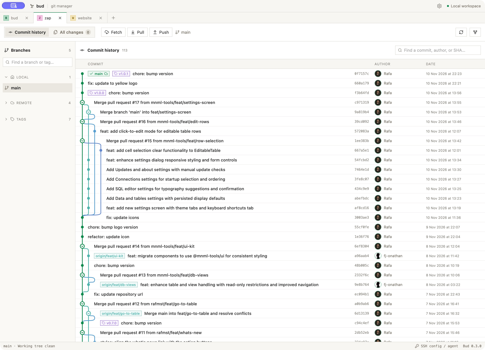

<p align="center">
  
</p>

<h1 align="center">Bud</h1>

<p align="center">
  <a href="https://github.com/mnml-tools/bud/actions/workflows/rust.yml"></a>
  <a href="https://github.com/mnml-tools/bud/actions/workflows/desktop.yml"></a>
</p>

<p align="center">
  A minimal desktop Git manager for local and remote repositories.
</p>

Bud lets you open or clone repositories, explore branches, and follow a colourful commit graph in one workspace. It’s built with Tauri, React, TypeScript, and Rust.

<picture>
  <source media="(prefers-color-scheme: dark)" srcset="docs/bud-screenshot-dark.png">
  <source media="(prefers-color-scheme: light)" srcset="docs/bud-screenshot-light.png">
  
</picture>

View screenshots in [light mode](docs/bud-screenshot-light.png) or [dark mode](docs/bud-screenshot-dark.png).

> [!IMPORTANT]
> **A note on AI use:** I’m against the blind use of AI and generally oppose generating large portions of code with it. That said, I used AI-generated code to build Bud: I wanted a custom tool for myself and chose to experiment with how quickly AI could help me build it. This was also a chance to study these tools from a user’s perspective, how they work, how to communicate with them, and how to use them to implement features. I want to understand this technology and keep up with it, even if I don’t use it every day.

## What you can do

- **Open or clone** Git repositories and reopen them from a searchable grid or list. Choose a repository avatar colour and switch between saved repositories from the header. Removing a saved repository only removes the shortcut; files stay on disk.
- **Explore branches** with local and remote-tracking branches in the sidebar. Switch local branches and jump to branch tips in the graph.
- **Browse history** across all refs with a colourful commit graph, merge connections, authors, dates, refs, and commit hashes. History loads in batches of 300 with virtualized rows.
- **Review changes** and stage files before committing. Write a commit message yourself or explicitly request an editable AI draft from a configured OpenAI-compatible provider. AI is disabled by default; see the [frontend architecture guide](docs/architecture.md#optional-ai-commit-drafts) for configuration and data handling.
- **Fetch and push** using a selected remote and SSH identity. Network operations run only when requested. Push asks for confirmation and pushes only the current branch, without force.
- **Manage SSH identities** by registering existing private keys, choosing a default for new repositories, and selecting an identity per repository. Saved key passwords stay in your operating system’s credential store.
- **Make it yours** with Light or Dark mode and five accent colours. Bud remembers your appearance settings and repository view. New installations default to green.

## Run locally

Install Git and make it available on PATH, alongside Node.js 22, Rust, and the [Tauri prerequisites](https://v2.tauri.app/start/prerequisites/) for your operating system. From the project root, run:

```sh
npm ci
npm run tauri dev
```

Use `npm run dev` to preview the interface in a browser. Git operations use the desktop runtime.

## Build desktop packages

### macOS

On a Mac with Xcode selected, run:

```sh
npm ci
npm run build:mac
```

This builds the desktop packages using the checked-in icons and produces:

- **App** at `src-tauri/target/release/bundle/macos/Bud.app`
- **DMG** in `src-tauri/target/release/bundle/dmg/`

For public distribution, see [Tauri’s macOS signing and notarization guide](https://v2.tauri.app/distribute/sign/macos/).

### Linux AppImage

Run the build on Linux after installing the [Linux build prerequisites](https://v2.tauri.app/start/prerequisites/#linux). From macOS, use a Linux VM or CI runner. Choose an x86_64 Linux environment for an Intel/AMD AppImage or an ARM64 Linux environment for an ARM64 AppImage.

```sh
npm ci
npm run icons:png
npm run tauri build -- --bundles appimage
```

Find the package in `src-tauri/target/release/bundle/appimage/` in your Linux checkout. See [Tauri’s AppImage guide](https://v2.tauri.app/distribute/appimage/) for distribution details.

## Automated desktop builds

The **Desktop builds** GitHub Actions workflow runs on every push to `main`,
on version tags matching `v[0-9]*`, and through **Run workflow** in the Actions tab.
It runs the frontend and Rust tests, then builds a Linux x86_64 AppImage and a
universal macOS `.app` for Apple Silicon and Intel Macs.

Download the packages from the workflow run's **Artifacts** section. Artifact
names include the commit SHA and downloads are retained for 14 days. Extract
`Bud-macos-universal.app.zip` to get `Bud.app`.

To publish a GitHub Release, update the versions in `package.json`,
`package-lock.json`, `src-tauri/Cargo.toml`, `src-tauri/Cargo.lock`, and
`src-tauri/tauri.conf.json`, commit the changes, then push a matching tag:

```sh
git tag v0.1.0
git push origin v0.1.0
```

The release is published after both platform builds pass, with both packages
attached. The workflow uses GitHub's built-in token for publishing. Version-tag builds also require the updater signing secrets described below.
macOS builds are not Developer ID signed or notarized, so downloaded apps may
require approval in macOS security settings. For public distribution, configure
[macOS signing and notarization](https://v2.tauri.app/distribute/sign/macos/).

## Automatic updates

Published version-tag builds check GitHub Releases once at startup (with a 15-second timeout).
When a newer version is available, Bud offers **Install and restart** or **Later**.
If the app reports unsaved changes, a second prompt lets you cancel and save your
work or explicitly discard changes. Updating is blocked while Git operations are running. A modal blocks
editing during download and installation. Failed checks do not interrupt startup;
failed installations show an error and allow retrying.

### Configure GitHub signing secrets

Generate an updater signing key pair on your own machine:

```sh
npm run tauri signer generate -- -w "$HOME/.tauri/bud.key"
```

In the repository's **Settings → Secrets and variables → Actions**, add:

| Secret                               | Value                                                                                                               |
| ------------------------------------ | ------------------------------------------------------------------------------------------------------------------- |
| `TAURI_SIGNING_PRIVATE_KEY`          | Full contents of `bud.key`, not its path.                                                                           |
| `TAURI_SIGNING_PRIVATE_KEY_PASSWORD` | The password chosen when generating the key; omit if unencrypted.                                                   |
| `TAURI_UPDATER_PUBLIC_KEY`           | Full contents of `bud.key.pub`. This is public information, stored as a secret for build configuration convenience. |

Back up the private key and its password securely. Keep using the same key pair for
future versions so existing installations can verify updates. Never commit the private key.
Updater signatures are separate from Apple Developer ID signing and notarization.

Tag builds embed the public key, generate signed updater artifacts, and publish
`latest.json`, the macOS `.app.tar.gz` and Linux AppImage, and their `.sig` files.
The manifest maps both Intel and Apple Silicon Macs to the universal macOS archive.
The release tag must match the app version, e.g. `v0.1.0` for `0.1.0`.
The GitHub repository and release assets must be publicly downloadable.

Ordinary branch and local builds do not require signing secrets; their updater key
is empty, so they cannot check for updates until configured. To build locally with
updates, set `plugins.updater.pubkey` to your public key and enable
`bundle.createUpdaterArtifacts` in a local Tauri config override, then provide the
`TAURI_SIGNING_PRIVATE_KEY` and optional password environment variables when building.
Development mode skips startup checks.

Existing installations need one manual upgrade to the first release containing
this updater. Test the full flow using two signed versions before relying on it
for distribution: install the older version, publish the newer version, reopen
Bud, verify cancel preserves dirty work, then install and restart.

## Development checks

```sh
npm run build
npm test
npm run format:check
cargo test --manifest-path src-tauri/Cargo.toml --locked
```

For UI checks with sample data, run the Vite server and open `/tests/git.html`. The fixture simulates native commands and never accesses real repositories or SSH keys. See the [frontend architecture guide](docs/architecture.md) for the code layout.

For a live author-avatar check against a public GitHub sample, open `/tests/git.html?github=1`. Author photos load from GitHub using the commit author’s profile or GitHub noreply identity, or from Gravatar using a SHA-256 hash of the commit email. GitHub lookup uses the public API without credentials; private repositories or API limits fall back to Gravatar or local initials.

## SSH identities

Use **SSH identities** to register a private key file with a friendly name. Bud stores the label and canonical file path in preferences. Optional key passwords are stored separately in the system credential store (Keychain on macOS, Credential Manager on Windows, or Secret Service on Linux). The identity selector above commit history applies to the opened repository; clone has its own selector.

Enter a key password when adding an identity, or use Set/Change password on an existing identity. Bud uses the saved password automatically for clone, fetch, and push. Encrypted keys without a saved password can still use your SSH agent. You can replace or remove a saved password; removing the identity also removes its stored password. The default **SSH config / agent** option uses your OpenSSH configuration and agent. Selected keys use `IdentitiesOnly=yes`. Unknown hosts must first be verified through SSH in a terminal; Bud keeps host verification enabled and does not show terminal password prompts. HTTPS remotes use existing Git credential helpers instead of SSH keys.

This version registers existing keys; it does not generate keys or upload public keys. Fetch and push act on the selected remote. Push asks for confirmation and pushes only the current branch, without force.

## Shortcuts

Use Command on macOS and Ctrl on other platforms:

| Shortcut                       | Action                                    |
| ------------------------------ | ----------------------------------------- |
| Command/Ctrl+P                 | Switch saved repositories from the header |
| Command/Ctrl+O                 | Open a local repository                   |
| Command/Ctrl+N                 | Clone a repository                        |
| Command/Ctrl+Shift+K           | Manage SSH identities                     |
| Command/Ctrl+R                 | Refresh the opened repository             |
| Command/Ctrl+F or double Shift | Focus commit search                       |
| Escape                         | Dismiss a popup when idle                 |

The shared shortcut dispatcher ignores background commands while a dialog is open. Dialogs retain focus trapping, Escape handling, and backdrop dismissal. Closing or installing an update waits for active Git operations.

## App icons

Edit `src-tauri/assets/AppIcon.icon` in Icon Composer, then run `npm run icons` on macOS with Xcode selected. This exports a temporary PNG, regenerates desktop and mobile icon assets, and compiles the native macOS icon catalog. The temporary PNG is removed afterward; `src/assets/AppIcon.png` is left unchanged. Other platforms use a flattened version of the default macOS appearance.

Run `npm run icons:mac` to compile only the native macOS icon catalog, or `npm run icons:png` to regenerate standard assets from the checked-in PNG on any platform.

## License

Bud preserves the original Zap license and attribution and is source-available under the custom [Zap Noncommercial Share-Alike
No-AI-Cloning License 1.0](LICENSE).

- Use, study, modify, and fork Bud for noncommercial purposes.
- Share copies and modified versions under the exact same license, with notices
  preserved and corresponding source provided to recipients.
- Commercial use, commercial forks, sales, paid hosting, and use in a
  profit-seeking business's operations are prohibited, even under the same license.
- Using AI to clone or substantially reproduce Bud from its protected materials
  is prohibited, including for noncommercial clones. AI assistance with
  understanding, testing, debugging, and maintaining a permitted fork is allowed.

The full license controls. Third-party dependencies retain their own licenses.
These restrictions make Bud source-available rather than open-source under the
[Open Source Definition](https://opensource.org/osd). The AI restriction does not
claim ownership of general ideas or independently created software.

## macOS Keychain prompts

When macOS asks Bud for access to a saved password, use your login Keychain password, usually your Mac login password. **Allow** grants one access and **Always Allow** remembers permission for that app identity. Development rebuilds can change the app identity and prompt again. See [Apple’s Keychain guide](https://support.apple.com/en-gb/guide/mac-help/kychn002/26/mac/26).
